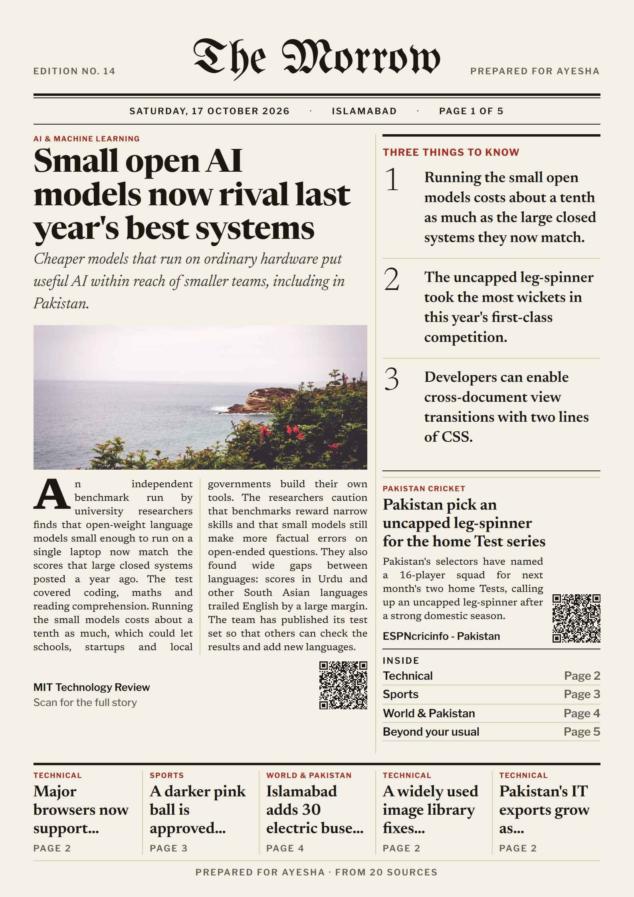
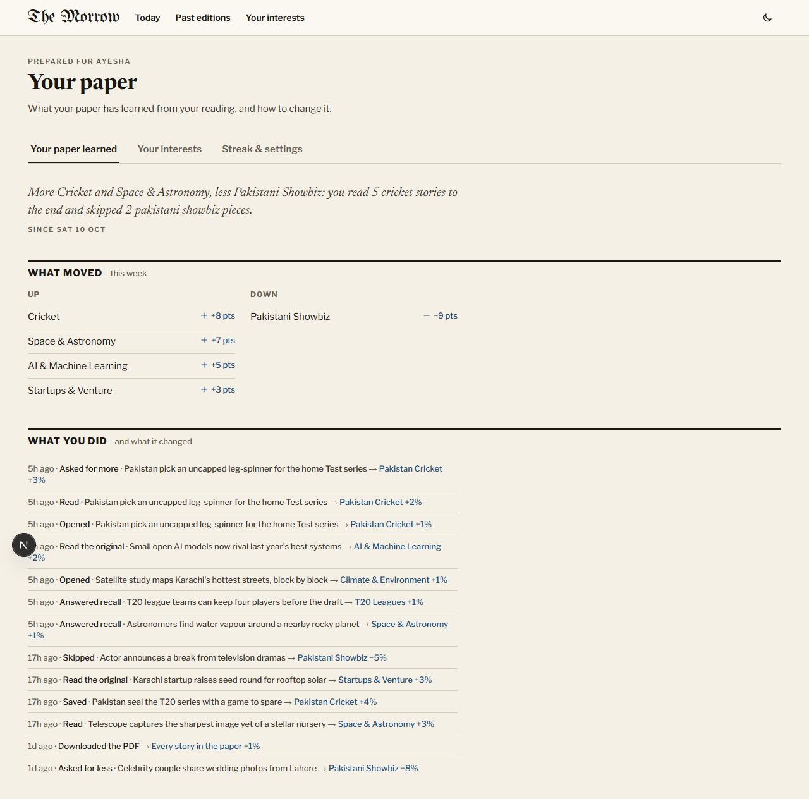
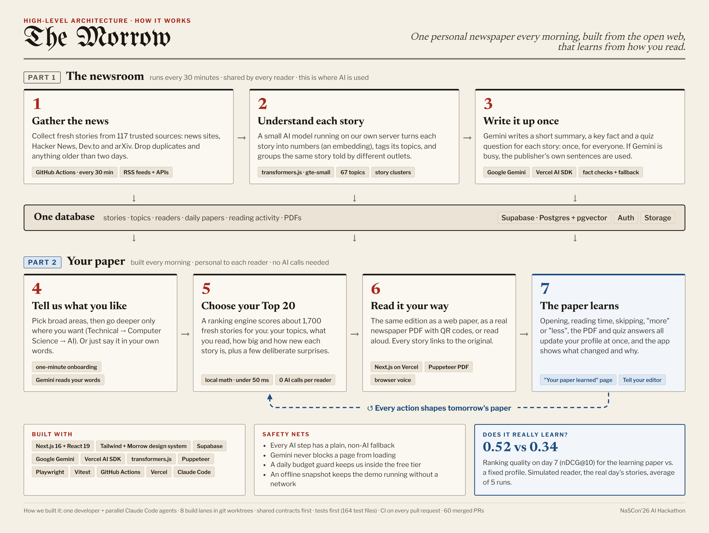

## Registered mail: muneebzehel@gmail.com
## Name: M. Muneeb Shafiq
## Number: 0316447****
# The Morrow: a personal morning paper

**Live:** https://personal-morning-paper-three.vercel.app

**One-click demo:** [`/demo`](https://personal-morning-paper-three.vercel.app/demo) signs in the seeded reader Ayesha (8 past editions, a 7-day streak) and opens today's paper; [`/start`](https://personal-morning-paper-three.vercel.app/start) builds your own paper with an anonymous sign-in.

Built in one day for the NaSCon'26 AI Hackathon (17 October 2026, Islamabad). Working name in the code: Subah.

Every morning, each reader gets one finite edition: twenty stories chosen for them from the roughly 1,700 articles that 117 verified sources publish in a day, laid out as a newspaper front page on the web and as an A4 newspaper PDF with their name on the masthead. Every story carries a short summary, its source, a link to the original, and a tag that says why it is in the paper. The morning opens with recall questions about yesterday's stories and closes with "three things you learned" and a reading streak. Opening, reading time, skipping, asking for more or less, downloading the PDF and answering recall questions all update the reader's model at once, so the next edition is different, and the learning page shows what moved and why.

<table>
  <tr>
    <td width="46%"></td>
    <td width="54%"></td>
  </tr>
  <tr>
    <td>The PDF edition, page 1 of 5 (<code>public/demo/sample.pdf</code>).</td>
    <td>The learning page at <code>/me</code>: what moved, and what each action changed.</td>
  </tr>
</table>

More screenshots (390 px and 1280 px, Morning and Night): [`docs/handoff/screens/`](docs/handoff/screens/).

## Demo flow

The five-minute walkthrough in [`docs/DEMO.md`](docs/DEMO.md), in the order of the five required features:

1. **Onboarding.** In a private window, `/start`: a first name for the masthead, then broad areas first and depth only where wanted (Technical › Computer Science › AI & Machine Learning), "In your words" ("Add to my topics" maps a sentence to topics), "Your routine" (Quick, Standard or Deep), "Preview my paper", then "Build my paper".
2. **Today's paper.** `/demo` opens Ayesha's Edition No. 8 at `/today`: Morning recall, a why-tag on every story and its "Why this story?" breakdown, Skip with Undo and a reason while a reserve story takes the slot, the story sheet and "Read on {source}", which goes through `/r/[articleId]` to the publisher.
3. **The PDF.** "Download PDF" serves her stored five-page A4 newspaper: the lead sized by her top interest, sections in her order, a QR code per story back to the web, and a last page with "Why these stories" and "Three things you learned". Without a stored PDF it opens `/paper/[date]/print` ("Print / Save as PDF").
4. **The archive.** "Past editions" (`/archive`) lists her eight papers with a month calendar; any one reopens at `/paper/[date]`.
5. **Learning, made visible.** `/me`: "What moved", the change summary, "What you did" (the signal timeline with each effect), "Fast-forward 7 days" (a simulated week against two baselines), and on "Your interests", "Tell your editor": plain words become a proposed change, confirmed by the reader, and today's paper is rebuilt.
6. **Room to explore.** "Listen · N min" reads the paper aloud with the browser's own voice, "Other angles" shows how several outlets covered one story, "Bytes" turns the paper into one card at a time, the streak sits quietly in the top bar (tap it for the streak panel: the week, today's goal, freezes and a 12-week heatmap), every story can be shared, saved stories collect on `/saved`, the paper installs as an app (web manifest and icons), and "How this paper was made" closes the paper.

## Architecture

**High level, in plain words.** The newsroom runs every 30 minutes for everyone, and is where AI is used. Your paper is built every morning for you with local math, and every action feeds back into tomorrow's paper.



Source: [`docs/architecture-high-level.html`](docs/architecture-high-level.html), rendered to PNG.

**Detailed view.** Every component, data store and job:



Source: [`docs/architecture-diagram.mmd`](docs/architecture-diagram.mmd) (PNG: [`docs/architecture-diagram.png`](docs/architecture-diagram.png)). The full specification is [`docs/ARCHITECTURE.md`](docs/ARCHITECTURE.md).

- **Sources** (`seed/feeds.json`, `seed/taxonomy.json`): 114 RSS feeds plus Hacker News, Dev.to and arXiv, seeded as 117 `sources` rows; a 67-node topic tree (9 roots, 44 second-level, 14 third-level) that onboarding, labelling and ranking all share.
- **Ingest** (`src/server/ingest`): fetches each feed with conditional requests and a 15 s timeout, decodes charsets, canonicalises URLs into a `url_hash`, keeps the last 48 hours, and bulk-inserts with `on conflict do nothing`; the first run stored 1,676 new articles from 3,412 items in 30 s. `.github/workflows/ingest.yml` runs ingest, NLP and enrichment every 30 minutes.
- **NLP** (`src/server/nlp`): embeds `title + first sentences` with `Supabase/gte-small` (384 dimensions, transformers.js on the CPU, no API quota), labels each article by cosine against the topic embeddings, joins same-story clusters by leader clustering at cosine 0.90, and scores importance by how many distinct outlets cover a cluster.
- **Enrichment** (`src/server/enrich`): Gemini reads each cluster representative once, ten articles per request, and returns a headline, three summary tiers, why it matters, a key fact and a recall question; deterministic guardrails check every number against the source, word bands, entity substrings and the grounding of the quiz answer, and anything that fails twice gets an extractive summary that ends on a sentence boundary, with consent walls, ad-blocker walls, newsletter promos, photo credits and scraped site navigation filtered out.
- **callLLM** (`src/server/ai`): the one wrapper around Gemini, with a cache keyed by `sha256(step|model|input)`, a per-day budget in `llm_usage` incremented through an atomic RPC, per-model request pacing, and a ladder from the smart model to the fast one to the fallback one to a deterministic result, so it never throws and never blocks on a rate limit.
- **Supabase**: Postgres with pgvector for articles, clusters, topics, editions, events, interests and streaks; anonymous Auth for readers plus one seeded demo persona; a private Storage bucket for PDFs behind signed URLs; row-level security with reads for the owner and writes only through the server.
- **buildEdition** (`src/server/edition`, `src/server/rank`): loads a 36-hour candidate pool (cached ten minutes per process) and the reader's model, runs the pure `rank-v1` ranker, writes the edition, its 20 stories plus 8 reserve stories, a receipt and an interest snapshot, and hands the editor's note to Gemini only after the response has been sent. The Vercel cron in `vercel.json` calls `/api/cron/editions` daily at 00:00 UTC.
- **Reader** (`src/app/(reader)`, `src/components/paper`, `src/components/story`): `/today`, `/paper/[date]`, `/archive`, the story sheet, skip with undo, Morning recall, the streak, Bytes, and `/r/[articleId]`, which logs the read and redirects to the publisher.
- **PDF** (`src/server/pdf`, `/paper/[date]/print`): the same edition rendered as A4 pages by Puppeteer where a browser exists (`scripts/render-pdfs.ts`, or `npm run job:editions` on a machine with Chrome) and stored in the bucket. `GET /api/editions/[date]/pdf` answers a 302 to the stored PDF's signed URL; on Vercel, where there is no Chrome, a miss answers with the print route, which prints from the browser.
- **Learning** (`src/server/learn`, `/api/events`, `/me`): every signal becomes a reward on the topics of that story and a nudge to the reader's profile vectors; the learning page reads the snapshots back as movers, a change summary and a timeline.
- **Tell your editor** (`src/server/editor`, `/api/editor/tell`, `/api/editor/apply`): the reader's words go through the same `mapTextToTopics` as onboarding; the verb in front of each topic decides the change (more, less, always, never), and the confirmed changes go through the interest editor's own path before a forced rebuild.
- **Other angles** (`src/server/perspectives`, `/api/perspectives/[clusterId]`): for a story covered by two or more outlets, Gemini writes once per cluster what the sources agree on, each outlet's angle and where they differ; the request path reads the stored answer or a fallback built from the sources' own words.
- **Listen** (`src/lib/audio`, `src/components/audio`): the browser's `SpeechSynthesis` reads the edition in page order, skipping skipped stories; a story read to its end counts as read. No server and no quota.
- **Demo clock and offline snapshot** (`src/server/time`, `src/server/demo`): with `DEMO_MODE=1` every route reads `requestNow()`, which honours the `subah_now` cookie set by `POST /api/demo/clock`, so "Next morning" works without waiting a day; with `DEMO_FALLBACK=1` the reader routes serve Ayesha from `public/demo/snapshot.json` with no database.

## How the paper learns

**The reader model.** One Beta(α, β) distribution per topic node, plus two 384-d profile vectors: `pos` (what they read) and `neg` (what they asked for less of). Onboarding sets the priors: a picked root starts at (2, 1), a picked second-level topic at (3, 1), a picked leaf at (4, 1), everything else at the pessimistic (1, 3); blocked topics are muted. A topic's affinity is the blend θ̂ = 0.6·m(topic) + 0.3·m(parent) + 0.1·m(grandparent), with m = α / (α + β).

**The signals** (`src/contracts/signals.ts`, emitted by `useSignals`, flushed every 2 s and with `sendBeacon` on page hide; values in `src/server/rank/params.ts`): impression −0.25, open 0 (the click is a question, the dwell is the answer), dwell up to +0.70 scaled by expected reading time, read original or QR scan +0.60, save or share +1.00, more +1.50, less −1.50, skip −0.50 (zero when the reason is "already seen" or "not today"), recall answer +0.40 right, PDF download +0.05 on every story in the edition. Per story that nets: scrolled past −0.25, skim about 0, full read +0.45, skip −0.75, less −1.75. A positive reward adds to α of each label on the story (weighted by label confidence, 0.3 to the parent and 0.1 to the grandparent), a negative one adds to β; impressions move the Beta only. The profile vectors move by an exponential moving average, η = 0.10 for `pos` and 0.15 for `neg`. A refold on every build weights history with a 14-day half-life toward the prior, never toward zero.

**The score.** `0.40·topic + 0.25·cos(pos, e)·min(1, nEngaged/10) − 0.15·max(0, cos(neg, e)) + 0.15·importance + 0.15·freshness + 0.05·sourceQuality`, with `freshness = exp(−ageHours / 24)`. Every cosine is taken around the candidate pool's mean vector (`src/server/rank/center.ts`). Stories seen in the last seven editions and dismissed clusters are excluded.

**The selection.** One story per cluster, a shortlist of 200, then: one big story (highest importance, at least 0.5); two explore slots chosen by Thompson sampling, drawing from the Beta posterior of every topic outside the reader's top five, so uncertain topics get tried; one serendipity story from an unseen root with cosine between 0.25 and 0.45 to the profile; and the rest filled by maximal marginal relevance (λ = 0.7) with caps of five per root and three per source. The random generator is seeded with `hash(userId | date)`, so an edition is reproducible, and every parameter lives in `DEFAULT_PARAMS`, which is stored on the edition row.

**Making it visible.** Every story carries a why-tag ("Because you follow Cricket", "Covered by 6 outlets today", "Trying something new", "A step outside your usual") and a "Why this story?" popover with the score breakdown. More and Less answer with a one-line note about tomorrow. The editor's note names the movers. `/me` shows the interest bars, the week's movers in points, a templated change summary built from real counts, the signal timeline with the effect of each action, an editor to pin, mute or set any topic, "Tell your editor", and a seven-day fast-forward of a simulated reader against onboarding-only and popularity baselines. The end of every paper shows "How this paper was made".

## Does it actually learn?

Measured on the real pool (1,000 articles, seven slices by publish time), mean over 5 seeds, with `npx tsx --env-file=.env.local scripts/simulate.ts`. The simulated reader loves cricket and AI, has a hidden interest in space she never picked, and dislikes Pakistani showbiz; her onboarding picks only Sports and Technical. Full table and reader model: [`docs/handoff/W3-learning.md`](docs/handoff/W3-learning.md).

| Arm | p@20, days 4–7 mean | nDCG@10, days 4–7 mean | p@20, day 7 | nDCG@10, day 7 |
|---|---|---|---|---|
| Learning | 0.148 | 0.511 | 0.150 ± 0.055 | 0.524 ± 0.051 |
| Onboarding only | 0.070 | 0.401 | 0.090 ± 0.058 | 0.344 ± 0.028 |
| Popularity | 0.063 | 0.360 | 0.050 ± 0.000 | 0.372 ± 0.000 |
| A random paper (base rate) | 0.119 | 0.428 | 0.147 | 0.440 |

**What was wrong, and the fix.** Before W3 the learning arm did not separate from onboarding-only (day 7 p@20 0.100 vs 0.050 in one deterministic run, and worse on nDCG@10). Two causes. The rewards made every open positive: a scroll-past cost −0.05 while any open paid +0.30 plus dwell, so every topic the paper showed drifted upward whatever she thought of it. And gte-small cosines were near-constant: the pool's mean pairwise cosine was 0.751, so the taste and "less like this" terms added the same amount to every story. Now every cosine is centred around the pool mean (mean pairwise cosine 0.010, about 2 ms of a 15 ms build), the impression costs −0.25 and the open itself 0; no score weight changed.

**Read honestly.** Her broad picks put the onboarding-only paper below chance; in a week, learning climbs back to about chance on p@20 and clearly above it on nDCG@10. The day-7 p@20 gap is about one standard deviation, so the nDCG@10 gap and the days 4–7 means are the stronger evidence. The ground truth inherits zero-shot label noise (rugby and football stories labelled `sports.cricket` count as liked), the reader model is assumed, not fitted to real logs, and only 9% of the pool (90 of 1,000) is something she truly likes. The chart on `/me` runs the same simulator live on the current pool, so its numbers move as new articles arrive; it plots precision@20.

## Model and algorithm efficiency

- **Gemini is never on the request path.** Ranking, reasons, tiers, recall selection and the template note are deterministic TypeScript. The exceptions have deadlines and fallbacks: the onboarding "in your words" mapping (and "Tell your editor", which reuses it) has a timeout and a keyword fallback; the editor's note runs in `after()`; "Other angles" is computed by a script and only read on the request path.
- **Each article is read once, for everyone.** Enrichment happens in the worker in batches of ten articles per request, cluster representatives first, and the output is shared by every reader and cached in `llm_cache`.
- **Budget guard.** `callLLM` counts requests per model per Pacific day in `llm_usage` and skips a model that has reached `GEMINI_RPD_*` before Google would return a 429; a 429 waits the body's `retryDelay` once, then steps down the ladder; the extractive summary and the template note are always available, and the receipt and `/api/health` report which one was used. The pipeline is designed to stay under about 250 requests a day on the free tier.
- **Embeddings cost nothing.** gte-small runs on the CPU (about 34 MB, downloaded once into `MODEL_CACHE_DIR`), and the topic embeddings are computed once by `npm run embed:topics`.
- **Ranking is small.** Scoring is N × 384 multiply-adds and MMR is 20 × 200 × 384; the unit test ranks 1,000 candidates in under 50 ms. A full `buildEdition` against the real database measured 3,567 ms cold and 1,219 ms warm, almost all of it database round trips; the pool is cached for ten minutes. The 5-seed simulation takes 1.9 s on the real pool.
- **Demo safety.** `DEMO_FALLBACK=1` serves the committed snapshot of Ayesha (`public/demo/snapshot.json`: 8 editions, 220 articles, the archive, the streak and the learning view) with no database; with `DEMO_MODE=1`, `/today/preview`, `/me/preview` and `?fixtures=1` render the contract fixtures; `public/demo/sample.pdf` and her first and latest PDFs are committed; the whole corpus has an extractive fallback, so the paper builds when Gemini is out of quota.

## How this was built

One developer orchestrated parallel Claude Code agents, one git worktree and branch per lane. The spec came first: thirteen research notes in [`docs/research/`](docs/research/), then [`docs/ARCHITECTURE.md`](docs/ARCHITECTURE.md) and [`docs/PLAN.md`](docs/PLAN.md) with one plan per lane in [`docs/plans/`](docs/plans/).

- **Contracts first.** Lane L0 wrote `src/contracts/*` (types, zod schemas for every request and response, the `ROUTES` constants, fixtures that pass their schemas), the 15-table migration, and a stub for every cross-lane function, component and route, so every lane compiled from minute one and replaced only its own stubs.
- **Eight lanes, then two more waves.** L0 Foundation, L1 Ingest, L2 AI and NLP, L3 Engine, L4 Reader UI, L5 Onboarding, L6 PDF, L7 Engagement, each with its own folders, dev-server port, plan and handoff file in [`docs/handoff/`](docs/handoff/). Wave 2 (ship kit and offline snapshot, Tell your editor, Listen, Other angles, docs) and wave 3 (learning measurement and fix, design QA at 390 and 1280 px) were planned from what shipped.
- **Tests first for pure modules.** The ranker, learner, simulator, streak machine, guardrails, extractive builder, URL canonicaliser, editor proposals, reading queue and time helpers all have Vitest suites; `tests/l0/routes.test.ts` pins every API route to its contract schema and to sanctioned status codes.
- **Rolling integration.** The integrator merged in dependency order with merge commits, never squashes, and CI (`.github/workflows/ci.yml`: typecheck, lint, Vitest, `next build`) runs on every push and pull request without a Gemini key.

Measured from the repository at `654ef46` (16:45 PKT): 287 commits between 11:12 and 16:45, 51 merged pull requests, 160 test files (`*.test.*` and `*.spec.*` in `src`, `tests` and `e2e`), and 1,351 passing Vitest tests in 155 files (3 files and 6 tests skipped: the gated model and database integration tests), 2 migrations, 8 lane plans, 77 screenshots. From the data: the first ingest stored 1,676 articles, which the NLP pass turned into 1,338 story clusters, 137 of them covered by two or more outlets.

## Run it locally

Requirements: Node 24, a Supabase project (free tier, with anonymous sign-ins enabled), a Gemini API key. Windows, macOS and Linux all work; every script is an npm script.

```bash
npm ci
cp .env.example .env.local                # then fill in the values below
npx supabase link --project-ref <ref>     # once; or paste supabase/migrations/*.sql into the SQL editor
npx supabase db push
npm run seed                              # topics=67 sources=117
npm run embed:topics                      # 67 topic vectors with local gte-small (first run downloads the model)
npm run job:ingest -- --limit=200         # ingest, then NLP, then Gemini enrichment; --limit caps the Gemini work
npx tsx scripts/seed-demo-persona.ts      # Ayesha: seven days of real history, then today's paper
npm run demo:snapshot                     # optional: refresh public/demo/snapshot.json from her papers
npm run dev                               # http://localhost:3000; /demo signs in the persona, /start builds your own
npm run typecheck && npm run lint && npm test && npm run build
```

Offline: set `DEMO_FALLBACK=1` and `DEMO_MODE=1` in `.env.local`, then `npm run dev`; `/demo` opens Ayesha from the snapshot and `/api/health` reports `"fallback":true`. Keep `DEMO_FALLBACK` off on a public deployment: in fallback mode every visitor is Ayesha.

| Variable | Meaning |
|---|---|
| `NEXT_PUBLIC_SUPABASE_URL`, `NEXT_PUBLIC_SUPABASE_PUBLISHABLE_KEY` | The project URL and the publishable key the browser may see. |
| `SUPABASE_SECRET_KEY` | The secret key for server routes and jobs; every write goes through it after the user is authenticated. |
| `GEMINI_API_KEY` | AI Studio key. Without it every AI step takes its deterministic fallback. |
| `GEMINI_MODEL_FAST`, `GEMINI_MODEL_FALLBACK`, `GEMINI_MODEL_SMART`, `GEMINI_MODEL_TTS` | Model ids per tier (defaults `gemini-3.5-flash-lite`, `gemini-3.1-flash-lite`, `gemini-3.8-flash`, `gemini-3.8-flash-tts`; the TTS tier is unused, Listen uses the browser's voice). |
| `GEMINI_RPD_*`, `GEMINI_RPM_*` | Per-model daily budgets and per-minute pacing for the guard (defaults 450/450/18 and 12/12/4). |
| `GEMINI_EMBED_MODEL`, `EMBEDDINGS_PROVIDER`, `MODEL_CACHE_DIR` | `local` (default, gte-small on the CPU) or `gemini` (gemini-embedding-2 at 384 dims); where the local model is cached. |
| `CRON_SECRET`, `NEXT_PUBLIC_APP_URL` | Bearer token for `/api/cron/*`; the public origin used in QR codes. |
| `DEMO_MODE`, `DEMO_FALLBACK`, `DEMO_USER_EMAIL`, `DEMO_USER_PASSWORD` | Demo clock and controls; the offline snapshot; the seeded persona's credentials. |
| `PUPPETEER_EXECUTABLE_PATH` | A local Chrome for PDF rendering and Playwright. |

The demo clock: `POST /api/demo/clock` with `{"now":"2026-10-18T02:00:00.000Z"}` sets the cookie (`{"now":null}` clears it); `/me`, tab "Streak & settings", has "Next morning" and "Reset clock". The reader's day rolls over at 03:00 local time.

## Design system: Morrow

The UI is composed only from the Morrow components and tokens in [`design/project/README.md`](design/project/README.md): warm paper and near-black ink, one red accent for kickers and the single accent button, and one blue, the editor's pen, that means "the paper learned this" and nothing else. Importance is shown by headline size and position rather than colour, sections are never colour-coded, and the same tokens drive the web paper, the Night edition and the PDF. The design QA pass ([`docs/handoff/W3-design-qa.md`](docs/handoff/W3-design-qa.md)) checked every page at 390 px and 1280 px in both themes.

## Judging criteria map

| Criterion | Where to look |
|---|---|
| Innovation and originality | Morning recall and "three things you learned" (`src/components/recall`); a finite, dated edition rather than a feed; why-tags and the "How this paper was made" receipt; Tell your editor; Other angles; explore and serendipity slots. |
| Technical complexity | The pipeline from 117 feeds to embeddings, clusters, guarded enrichment and a budgeted LLM ladder (`src/server/{ingest,nlp,enrich,ai}`); the pure ranker, learner and simulator (`src/server/{rank,learn}`); the A4 PDF renderer (`src/server/pdf`). |
| Practical impact and usability | Onboarding in four steps with no sign-up form and the first front page at the end of it; "Read on {source}" on every story; the PDF and its QR codes; the archive; Listen; the print fallback; the offline snapshot. |
| Model and algorithm efficiency | One Gemini pass per article shared by all readers; zero per-reader LLM calls on the request path; local 384-d embeddings with centred cosines; the `llm_usage` budget guard; the measured simulation above. |
| Presentation clarity | This README, the diagram, [`docs/ARCHITECTURE.md`](docs/ARCHITECTURE.md) with one sentence per box, [`docs/DEMO.md`](docs/DEMO.md). |
| Team collaboration | The pull-request list and commit history, the contracts in `src/contracts`, the per-lane plans and handoff notes, CI on every push. |
| UI and UX | The Morrow design system; 390 px and 1280 px screenshots in `docs/handoff/screens`; the W3 design QA findings and fixes; keyboard pass and reduced motion noted in `docs/handoff/L7.md`. |

## Limits and next steps

- **Gemini free tier.** The quota is shared by every job and dev run and resets at 12:00 PKT, so part of the corpus is extractive and only Gemini-enriched stories carry recall questions; the receipt shows the share. Tier-1 billing or a nightly batch would fill the rest.
- **PDF on Vercel.** There is no Chrome on Vercel and `@sparticuz/chromium` is not wired, so only stored PDFs download; a reader without one, or a paper rebuilt by "Tell your editor" or "Next morning", gets the print route until `scripts/render-pdfs.ts --all-missing` or the editions job runs where a browser exists. The committed persona PDFs in `public/demo` and the stored PDFs served on the live site both link to the live URL.
- **Still stubbed or partial.** `grep -rl "STUB (L0)" src scripts` lists one file: `scripts/snapshot.ts` (`npm run snapshot`, a corpus dump; the demo snapshot `npm run demo:snapshot` is real). "Other angles" is stored for the 20 most important multi-source clusters of Ayesha's papers; no scheduled job computes it yet, so other stories show the fallback from the sources' own words. In `DEMO_FALLBACK` mode writes still need the network and "Next morning" serves the latest snapshot paper again.
- **Schedules.** The ingest workflow is on `main`; its first run (dispatched by hand, 15:55 PKT) succeeded in 5 minutes. The editions cron runs daily at 00:00 UTC.
- **The simulation is a simulation.** See "Does it actually learn?": an assumed reader model, noisy zero-shot labels, and a day-7 p@20 gap of about one standard deviation. Real readers over real days are the next test.
- **Cut for the day** (see `docs/PLAN.md` §5a): the swipe taste test (the onboarding preview still uses `/api/taste` for its headlines), Urdu, the two-host podcast (Listen uses the browser's voice instead), offline reading in the installed app (it installs, but there is no service worker), and on-demand Chromium on Vercel. Saved stories come from the server event log, so un-saving does not remove a story from `/saved` yet.
- **Next:** per-reader PDFs rendered right after each build, perspectives in the daily job, a queue in front of ingestion and rendering, and the remaining design QA items (Morrow's 32 px small buttons, the dateline separator that wraps at 390 px).

## Documents

[`docs/ARCHITECTURE.md`](docs/ARCHITECTURE.md) (specification and contracts) · [`docs/PLAN.md`](docs/PLAN.md) (lanes, timeline, cut lines) · [`docs/DEMO.md`](docs/DEMO.md) (Loom script and Q&A) · [`docs/research/`](docs/research/) (13 research notes) · [`docs/plans/`](docs/plans/) (one plan per lane) · [`docs/handoff/`](docs/handoff/) (what each lane shipped and how to verify it) · [`design/project/README.md`](design/project/README.md) (the Morrow design system).
