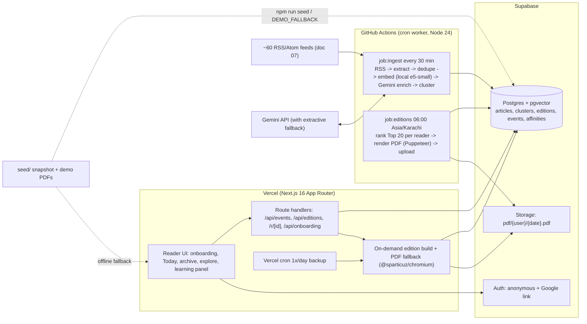

# 11: Stack, architecture, infra and repo layout (verified 2026-10-17)

Research agent 11. Versions were checked on the npm registry today, and platform limits come from official docs fetched today. Anything I could not confirm is marked (unverified).

## TL;DR
- **Keep the stack we already chose: Next.js 16 (App Router) + Supabase (Postgres + pgvector, Auth, Storage) on Vercel Hobby.** It fits one Windows developer running many Claude Code agents better than any alternative. Supabase covers four needs (DB, vectors, auth, file storage) with one key pair. Agents also know Next.js and Postgres best.
- **Do the heavy work in GitHub Actions, not on Vercel.** One Node script, `npm run job:ingest`, runs every 30 min. Another, `npm run job:editions`, runs at 06:00 `Asia/Karachi`. Both run on a full Ubuntu VM, so they get no 300 s limit, local transformers.js embeddings, and full Puppeteer for PDFs. Vercel Hobby cron cannot do this: it allows **one run per day, with ±59 min precision**.
- **Never make a reader wait for a cron.** Onboarding builds that reader's first edition on the spot (in-memory ranking over already-enriched articles, under 10 s). The daily job only refreshes editions.
- **Auth: Supabase anonymous sign-in on first visit, with an optional "Save with Google" button (`linkIdentity`).** A `/demo` button signs in a seeded persona. **Raise the anonymous sign-in limit** (30 per hour per IP by default) before judging, because the whole venue shares one Wi-Fi IP.
- **Write the contracts before anything else.** One lead lane spends 45 min committing `src/contracts/` (zod schemas + TS types), the full SQL migration, generated DB types, every dependency in `package.json`, and stub routes that return fixtures. After that, 5-6 lanes work in separate folders and git worktrees.
- **The demo never breaks.** A frozen snapshot of enriched articles and editions lives in `seed/`, together with pre-rendered PDFs. `npm run seed` loads it idempotently. With `DEMO_FALLBACK=1`, the app serves the snapshot if Supabase or Gemini fail. Request paths never call Gemini synchronously.

---

## Findings

### 1. Options compared
| Option | Fit for 9-10 h, 1 dev + parallel agents | Jobs / heavy work | Auth (Google + anonymous) | Explainability to judges | Verdict |
|---|---|---|---|---|---|
| **(a) Next.js 16 + Supabase + Vercel** | Best. One platform for DB, pgvector, auth and storage. Agents know it well. Hosted project, so no Docker on Windows | Vercel Hobby cron daily only (see 2). Pair it with GitHub Actions or `pg_cron` + `pg_net` | Built in: `signInAnonymously()` + `linkIdentity({provider:'google'})` | High: "Postgres + a ranking function + a daily job" | **Recommended** (already decided in CLAUDE.md) |
| (b) Next.js + Neon + Drizzle + Better Auth | Good. Drizzle schema doubles as typed contracts. But storage (Vercel Blob/R2) and cron are separate services, and auth tables have to be wired by hand | Same as (a) | Better Auth 1.7.10 supports Google; anonymous plugin (unverified today) | High | **Runner-up** |
| (c) Next.js + Python FastAPI service | Two runtimes, two deploys, CORS, a second env file. Python's ML ecosystem gives nothing we need, since embeddings run in JS (transformers.js) or Gemini | A long-running worker needs a host (Render/Railway/Fly; unverified free tiers) | Must bridge Supabase JWTs into FastAPI | Medium | No: integration cost alone is 2+ h |
| (d) Convex 1.47.0 | Strong (reactive DB, built-in crons and vector search), but a new paradigm for agents. Data is documents, not SQL | Built-in crons + actions; Chromium in Convex actions (unverified) | Convex Auth / Clerk; anonymous (unverified) | Medium: judges can't read SQL | No |
| (e) Totalum | Generates the app for us, which costs **control and authorship**: | Cron: Free plan 2 jobs, shortest interval **1 hour** | Built in | Low: "an AI builder wrote it" | **No** (details below) |

**Totalum, verified from its docs today:**
- **Stack:** Next.js App Router on **Cloudflare Workers** ("one Worker per project and environment"), with SQLite on **D1** via Drizzle. Code in `src/` runs on Workers, "not Node", so there is no filesystem and no long-lived connections. That rules out Puppeteer and transformers.js.
- **Free-plan monthly caps:** AI text 300 calls, embeddings 1,000, web scraping 100, PDF 200, vector search 10,000. Projects created from the API/MCP get a 5,000-credit development budget and 300 infrastructure credits. Hourly spend caps: 120 credits (account) and 40 (emergency stop).
- **Prices:** `/pricing` returned 404, so per-credit prices are (unverified).
- **GitHub:** sync is "two-way … with a repository you own", via a fine-grained PAT. Totalum pushes to `develop`/`main`, and "commits pushed straight to `main` are not deployed and are overwritten by the next publish". The commit author identity is (unverified). Commits would mostly come from Totalum's agent, which works against "all commits monitored" and Team Collaboration. Only one prompt runs per project at a time, which kills parallel agents.

### 2. Background job runners (limits from official docs)
| Runner | Frequency | Precision | Max run | Heavy work (Chromium, local embeddings) | Notes |
|---|---|---|---|---|---|
| **Vercel Cron (Hobby)** | **Once per day.** "Expressions … `*/30 * * * *` will fail deployment" | **±59 min** ("`0 1 * * *` … between 1:00 am and 1:59 am") | Function limit: **300 s** on Hobby, 2 GB / 1 vCPU, 250 MB bundle | Chromium via `@sparticuz/chromium` fits. transformers.js plus the model is heavy | Good as a **backup** trigger for the daily build |
| **GitHub Actions `schedule`** | Every **5 min** at most | "Can be delayed during periods of high loads"; supports an **IANA timezone** | 6 h per job (unverified today) | **Yes**: full Node 24 VM, Chrome, no bundle limit | Runs only on the default branch. Public repos: disabled after 60 days without activity. Private repos use Actions minutes (free quota unverified today; the repo goes public at submission) |
| **Supabase Cron** (`pg_cron` + `pg_net`) | Down to every second | Precise | Docs: keep jobs ≤10 min, ≤8 concurrent | No: it only *triggers* an HTTP call (`net.http_post`, 2,000 ms default timeout, fire-and-forget) | Precise trigger for Vercel routes. Free-plan availability of pg_net (unverified) |
| Inngest | Hobby: 50k executions/month, 5 concurrent steps | — | — | Steps run inside our Vercel functions | Cron on Free (unverified). Adds an SDK and a dashboard; not needed |
| Trigger.dev | Free: $5/month credit, 10 schedules, 20 concurrent runs, "no maximum duration" | — | Unlimited | Yes (its own workers) | Good, but it's one more account plus a deploy step |

**Decision:** GitHub Actions runs the scripts. The same scripts are exposed as authenticated Vercel routes, so we can trigger them by hand in the demo ("Rebuild my paper now"). One extra Vercel Hobby cron (`0 0 * * *` UTC = 05:00-05:59 PKT) calls `/api/cron/editions` as a safety net. The scripts are idempotent: an edition is unique on `(user_id, edition_date)` and articles are unique on `url_hash`, so double runs are harmless.

### 3. Where heavy work runs
| Work | Where | Why |
|---|---|---|
| RSS fetch, readability extraction, dedupe | GH Actions `job:ingest` | Many sequential network calls; no 300 s limit |
| Embeddings (384-d, `Xenova/multilingual-e5-small` via `@huggingface/transformers@4.3.1`, per doc 09) | GH Actions | No key and no rate limit, so it doesn't spend the Gemini quota. Fallback: `gemini-embedding-2` with `outputDimensionality: 384` (range 128-3072; 768 recommended) |
| Gemini enrichment (summaries ×3, labels, entities; once per article) | GH Actions, with a concurrency cap and retry/backoff | Shared by all readers, so it isn't per user. Free-tier RPM/RPD appear only in AI Studio (unverified) |
| Taxonomy-node embeddings | Committed once into `seed/taxonomy.embeddings.json` | The web app never needs an embedding model at request time |
| Ranking + edition build | A pure TS function in `src/server/rank`, called by both GH Actions and the Vercel route | Under 10 ms per user in memory (doc 08), so on-demand building is safe |
| PDF render | Daily: GH Actions with full `puppeteer`, uploaded to Storage. On demand: Vercel route with `puppeteer-core` + `@sparticuz/chromium@153` (doc 10). Last resort: `window.print()` on `/paper/[date]/print` | Pre-rendering means a download is just a Storage URL |

### 4. Next.js 16 conventions agents must follow (Context7, `vercel/next.js` docs)
- `middleware.ts` is now **`proxy.ts`**, exporting `proxy()`; the `middleware` export is deprecated. Supabase session refresh goes there.
- `params` and `searchParams` are **Promises**, so write `const { date } = await params`. Route handlers can type `ctx: RouteContext<'/api/editions/[date]'>`.
- `export const maxDuration = 60` per route segment. On Hobby the cap is 300 s.
- Next 16.4.2 needs Node ≥20.9. AI SDK 7 and supabase-js 2.118 need Node ≥22, so **use Node 24** (installed locally: v24.19.0).
- Supabase now issues **publishable/secret keys** (`sb_publishable_…`, `sb_secret_…`). `anon`/`service_role` are "legacy" and slated for deprecation by end of 2026. Env names: `NEXT_PUBLIC_SUPABASE_URL`, `NEXT_PUBLIC_SUPABASE_PUBLISHABLE_KEY`, `SUPABASE_SECRET_KEY`. Use `supabase.auth.getClaims()` on the server.

---

## Recommended architecture


One sentence per box: *the worker gathers and understands stories once for everyone; Postgres stores them along with each reader's taste; the web app ranks 20 for you, logs what you read, and the next edition learns from it.*

### DB schema outline (one migration file, owned by the contracts lane)
```
users_profile   (user_id uuid pk -> auth.users, display_name, tz default 'Asia/Karachi', reading_level, created_at, is_demo bool)
taxonomy_nodes  (id text pk e.g. 'tech.cs.webdev', parent_id, level 1-3, label, description, embedding vector(384))
user_interests  (user_id, node_id, alpha real, beta real, prior_alpha, prior_beta, source 'onboarding'|'learned', updated_at; pk(user_id,node_id))
user_vectors    (user_id pk, profile vector(384), negative vector(384), updated_at)
sources         (id, name, feed_url unique, homepage, country, default_node_id, active, last_fetched_at, last_status)
articles        (id, source_id, url, url_hash unique, title, lede, body_excerpt, image_url, author, published_at, word_count, lang,
                 embedding vector(384), labels jsonb [{node_id,conf}], entities jsonb, summary_brief, summary_std, summary_deep,
                 enrich_status 'raw'|'embedded'|'enriched'|'fallback', cluster_id, created_at)
clusters        (id, centroid vector(384), first_seen, last_seen, source_count, importance real, headline, how_outlets_differ)
editions        (id, user_id, edition_date date, status 'building'|'ready'|'failed', layout jsonb (section order, lead id),
                 editor_note, pdf_path, build_ms, llm_calls, receipt jsonb, created_at; unique(user_id, edition_date))
edition_items   (edition_id, rank int, article_id, section_node_id, depth 'brief'|'std'|'deep', slot 'exploit'|'explore'|'serendipity'|'big',
                 score real, reasons jsonb (score breakdown for "why this story"); pk(edition_id, rank))
events          (id bigserial, user_id, edition_id, article_id, type 'impression'|'open'|'open_original'|'dwell'|'skip'|'less_like'|'more_like'|'save'|'pdf_download'|'qr_scan'|'quiz_answer',
                 value real (dwell sec / correctness), meta jsonb, created_at)  -- append-only; learning is a fold over events
streaks         (user_id pk, current int, longest int, last_read_date date, freezes int)
quizzes         (edition_id pk, questions jsonb)   quiz_answers (edition_id, user_id, q_index, choice, correct; pk(...))
job_runs        (id, job 'ingest'|'editions', started_at, finished_at, status, stats jsonb)  -- powers a public "newsroom status" panel
```
RLS: readers can read and write only their own rows in `users_profile`, `user_interests`, `events`, `streaks`, `editions` and `edition_items`. `articles`, `clusters`, `sources` and `taxonomy_nodes` are publicly readable. Jobs use `SUPABASE_SECRET_KEY`, which bypasses RLS.

### API surface (route handlers; request and response shapes in `src/contracts/api.ts` as zod)
| Route | Purpose |
|---|---|
| `POST /api/onboarding` | `{nodeIds[], depthPrefs}` → writes priors and builds today's edition synchronously → `{editionDate}` |
| `GET /api/editions/today` · `GET /api/editions?before=&limit=` · `GET /api/editions/[date]` | Edition + items (+ reasons); archive list |
| `POST /api/events` | Batched events (`navigator.sendBeacon`-friendly). Updates Beta(α,β) and the profile vector inline (cheap) |
| `GET /r/[articleId]?src=web\|print` | Logs `open_original`/`qr_scan`, then 302s to the source |
| `GET /api/editions/[date]/pdf` | Storage signed URL, or render on demand, or 503 + a `window.print()` hint |
| `POST /api/editions/rebuild` | "Rebuild my paper now" (demo; also shows the learning delta) |
| `GET /api/me/learning` | Affinity before and after, top movers, for the "Your paper learned" panel |
| `POST /api/quiz/[date]` | Quiz answers → events + streak |
| `GET /api/cron/{ingest,editions}` | `Authorization: Bearer ${CRON_SECRET}`; the same code as the GH Actions scripts |
| `GET /api/health` | DB, Gemini, last job run → the UI shows a "running on cached edition" badge when degraded |

### Repo layout (single Next.js app, no monorepo; Turborepo isn't worth it for one app)
```
src/contracts/        LEAD ONLY  zod schemas, TS types, database.types.ts (generated), fixtures.ts
supabase/migrations/  LEAD ONLY  0001_init.sql; later changes as <timestamp>_<lane>_<what>.sql (new files never conflict)
src/server/ai/        L1  Gemini client wrapper: retry, rate-limit queue, extractive fallback
src/server/ingest/    L1  feeds, extract, dedupe, embed, cluster        scripts/job-ingest.ts
src/server/rank/      L2  score, MMR, Thompson slots, layout decisions; pure functions + vitest
src/server/edition/   L2  buildEdition(userId,date), learning fold      scripts/job-editions.ts, scripts/simulate.ts
src/app/(reader)/     L3  today, paper/[date], archive, story sheet; src/components/paper/
src/app/onboarding/   L4  hierarchical picker; src/components/onboarding/; auth + streaks in src/server/auth, src/server/streaks
src/server/pdf/       L5  print template + renderer; src/app/paper/[date]/print/
src/app/explore/      L6  explore / AI extras; seed/ + scripts/seed.ts + public/demo/
src/app/globals.css + src/styles/tokens.css   DESIGN lane only (design-system tokens)
.github/workflows/    ingest.yml, editions.yml, ci.yml (typecheck + test + build)
docs/                 ARCHITECTURE.md, PLAN.md, HANDOFF.md
```
Conflict hot spots and their fixes:
- `package.json`/lockfile: the lead installs **every** dependency during scaffolding, and lanes don't add packages without a HANDOFF note.
- `layout.tsx`/nav: the lead creates the nav with all routes stubbed.
- `.env.example`: lead-owned.
- Migrations: one file per change, never edit an existing one.

### Seed / demo-data strategy
1. **T+0:45, fixtures:** `src/contracts/fixtures.ts` holds 25 hand-written articles and one edition. Every UI lane builds against these before real data exists.
2. **T+5:00, snapshot:** `npm run snapshot` exports the live DB (about 500-800 enriched articles with embeddings, clusters, and editions for 3 personas) to `seed/snapshot/*.json`, which is committed.
3. **Personas:** 3 seeded users (`is_demo=true`, e.g. student/techie, business/cricket, arts/health), each with 7 days of synthetic events from `scripts/simulate.ts` (doc 08's simulated reader), so the archive and learning charts are full.
4. **PDFs:** pre-rendered persona PDFs go in Storage **and** in `public/demo/`, so they download with zero dependencies.
5. **Fallback:** `DEMO_FALLBACK=1` makes the data layer catch Supabase errors and read from `seed/snapshot`. The edition page never calls Gemini during a request.
6. **`npm run seed` is idempotent** (upsert on natural keys), so we can re-run it minutes before the demo.

### Version pins (npm registry, 2026-10-17). Use `save-exact=true` in `.npmrc`
| Package | Pin | Published | Note |
|---|---|---|---|
| next / create-next-app | **16.4.2** | 2026-10-15 | 16.4.1 if 16.4.2 misbehaves |
| react / react-dom | 19.3.1 | 2026-10-14 | |
| @supabase/supabase-js | 2.118.0 | 2026-10-15 | Node ≥22 |
| @supabase/ssr | 0.12.7 | 2026-09-08 | |
| supabase (CLI, devDep) | 2.121.0 | 2026-10-14 | Run via `npx supabase` on Windows |
| ai (Vercel AI SDK) + @ai-sdk/google | 7.0.143 + 4.0.99 | 2026-10-16 | Or use `@google/genai` 2.30.0 directly |
| @huggingface/transformers | 4.3.1 | 2026-10-06 | Jobs only, never the Vercel bundle |
| zod | 4.6.7 | 2026-10-12 | |
| tailwindcss | 4.3.3 | 2026-07-16 | |
| typescript | whatever create-next-app installs | — | Latest is 7.0.2. If tooling breaks, pin 6.0.3 |
| puppeteer (jobs, local) | 25.14.0 | 2026-10-14 | |
| puppeteer-core + @sparticuz/chromium (Vercel) | **25.11.0** + **153.0.0** | 2026-09-14 / 09-11 | Must match the Chrome major (doc 10) |
| vitest / @playwright/test / tsx | 5.0.5 / 1.64.1 / 4.23.15 | Oct/Sep 2026 | |
| Node | 24.x | — | Local v24.19.0. Set `"engines": {"node": "24.x"}` and pick Node 24 in Vercel (Vercel 24.x support unverified today) |

### Setup commands (Windows PowerShell, lead lane)
```powershell
git clone https://github.com/munib123/personal-morning-paper.git; cd personal-morning-paper
npx create-next-app@16.4.2 . --ts --tailwind --eslint --app --src-dir --import-alias "@/*" --use-npm   # repo dir must be near-empty
Set-Content .npmrc "save-exact=true" -Encoding utf8
npm i @supabase/supabase-js@2.118.0 @supabase/ssr@0.12.7 zod@4.6.7 ai@7.0.143 @ai-sdk/google@4.0.99 puppeteer-core@25.11.0 @sparticuz/chromium@153.0.0
npm i -D supabase@2.121.0 tsx@4.23.15 vitest@5.0.5 @playwright/test@1.64.1 puppeteer@25.14.0 @huggingface/transformers@4.3.1
npx supabase login; npx supabase init; npx supabase link --project-ref <ref>      # hosted project; no Docker needed
npx supabase migration new init        # paste schema -> supabase/migrations/<ts>_init.sql
npx supabase db push
npx supabase gen types typescript --linked | Out-File -Encoding utf8 src/contracts/database.types.ts
npm i -g vercel; vercel link; vercel env pull .env.local
git worktree add ..\pmp-ingest -b lane/ingest   # repeat per lane: rank, reader, onboarding, pdf, explore
```
In Supabase Auth settings: enable **Anonymous sign-ins**, **Manual linking** and **Google**. Raise the anonymous rate limit. Add the Vercel URL and `http://localhost:3000` to the redirect URLs. GitHub repo secrets: `SUPABASE_URL`, `SUPABASE_SECRET_KEY`, `GEMINI_API_KEY`. Vercel env: the same keys plus `NEXT_PUBLIC_*` and `CRON_SECRET`.

---

## Recommendations for our build (ranked; effort = Claude Code agent hours)
1. **Contracts-first scaffold** (lead lane, T+0 to 0:45): create-next-app, every dependency, `src/contracts` + fixtures, the full migration + generated types, stub routes returning fixtures, `proxy.ts` session refresh, nav, `.env.example`, CI workflow. **0.75 h.** Everything else blocks on this.
2. **GitHub Actions worker** (`ingest.yml` `*/30`, `editions.yml` `0 6 * * *` with `timezone: Asia/Karachi`, plus `workflow_dispatch` on both) calling `npm run job:*`, and `job_runs` logging. **0.5 h** (the scripts themselves belong to L1/L2).
3. **Auth flow:** anonymous on first visit, `/demo` persona sign-in, "Save with Google" via `linkIdentity`, `/auth/callback` route. **1 h.** If Google OAuth setup takes more than 20 min, ship anonymous + demo only.
4. **On-demand `buildEdition()`** shared by onboarding, rebuild and cron, idempotent on `(user_id, edition_date)`. **1.5 h** (L2).
5. **Seed + snapshot + `DEMO_FALLBACK`** data layer and the `/api/health` badge. **1.5 h** (L6, starting around T+4:30).
6. **PDF pipeline:** pre-render in the job, Storage signed URL, on-demand Chromium fallback, `window.print()` last resort. **2 h** (L5, per doc 10).
7. **Vercel cron backup** (`vercel.json` `"0 0 * * *"` → `/api/cron/editions` with `CRON_SECRET`). **0.25 h.**
8. **Runner-up switch:** only if Supabase is blocked for more than 20 min (signup, region, outage). Switch to Neon + Drizzle + Better Auth + Vercel Blob, keeping the same contracts and lanes. **+2 h.**

## Innovation ideas
- **"Newsroom status" panel:** a live view of `job_runs` and source health (articles ingested, clusters, Gemini vs. fallback share, last build ms). It makes the pipeline visible, which scores Technical Complexity and Efficiency. **1 h, wow 3.**
- **Edition diff ("what changed because of you"):** compare today's `edition_items.reasons` with yesterday's, and show the topics that moved and the signals behind each move. It makes learning visible from the infrastructure we already have. **1.5 h, wow 4.**
- **Deterministic "time machine":** `simulate.ts` replays 7 days of a persona against the snapshot in seconds and plots precision@20 over the days. The same code serves the demo button and the Loom. **1.5 h, wow 4** (shared with doc 08).

## Risks
- **Anonymous sign-in limit, 30/hour per IP:** at a venue on one NAT, judges and the team can hit it. Raise it in the dashboard, and keep the `/demo` persona login as a bypass.
- **Gemini free-tier quotas are unknown** (shown only in AI Studio). Enrich in the job with a concurrency cap, cache by `url_hash`, and fall back to extractive summaries (doc 09). Never call Gemini synchronously during a request.
- **GitHub Actions schedule delays:** "can be delayed during periods of high loads." The daily edition and onboarding builds don't depend on it, and the Vercel cron is a backup.
- **Private-repo Actions minutes:** the free quota is (unverified). A 2-3 min ingest run every 30 min uses about 100-150 min/day. Drop to every 60 min if minutes look tight. They become free once the repo is public.
- **Serverless Chromium on Vercel:** version-match pain and cold starts. PDFs are pre-rendered in Actions, and `public/demo/` PDFs back them up.
- **Supabase free tier:** 500 MB DB, 1 GB storage, 50 MB per upload, 2 projects, paused after 1 week of inactivity. That's fine for the hackathon. 384-d vectors are about 1.5 KB per article.
- **Next 16 drift:** agents trained on Next 13-15 will write `middleware.ts` and synchronous `params`. Put the conventions in section 4 into `docs/ARCHITECTURE.md`.
- **Parallel-agent merge conflicts on `package.json`, migrations and layout:** fixed by lead ownership, adding only new migration files, and installing all dependencies at T+0.

## Sources
- Vercel cron limits: https://vercel.com/docs/cron-jobs/usage-and-pricing
- Vercel function limits: https://vercel.com/docs/functions/limitations
- GitHub Actions schedule: https://docs.github.com/en/actions/reference/workflows-and-actions/events-that-trigger-workflows
- Supabase Cron: https://supabase.com/docs/guides/cron · pg_net: https://supabase.com/docs/guides/database/extensions/pg_net
- Supabase anonymous auth: https://supabase.com/docs/guides/auth/auth-anonymous · API keys: https://supabase.com/docs/guides/api/api-keys · Pricing: https://supabase.com/pricing
- Supabase SSR (Context7 `/supabase/supabase`, `/supabase/ssr`): https://github.com/supabase/supabase/blob/master/apps/docs/content/guides/auth/server-side/creating-a-client.mdx
- Next.js 16 upgrade / proxy / maxDuration (Context7 `vercel/next.js`): https://github.com/vercel/next.js/blob/canary/docs/01-app/02-guides/upgrading/version-16.mdx
- Gemini embeddings: https://ai.google.dev/gemini-api/docs/embeddings · rate limits: https://ai.google.dev/gemini-api/docs/rate-limits
- Totalum: https://www.totalum.app/docs · https://www.totalum.app/docs/mcp · https://www.totalum.app/docs/developers · https://www.totalum.app/docs/developers/github · https://www.totalum.app/docs/limits
- Inngest pricing: https://www.inngest.com/pricing · Trigger.dev pricing: https://trigger.dev/pricing
- npm registry (`npm view <pkg> version time`), queried 2026-10-17
- Sibling research: docs/research/08-recommendation-learning.md, 09-ai-pipeline.md, 10-pdf-generation.md, 12-hackathon-strategy.md
